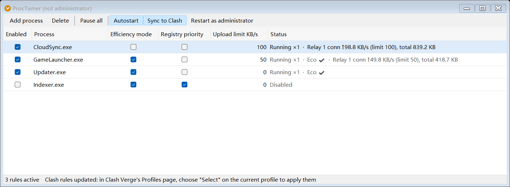

# ProcTamer

**English** | [简体中文](README.zh-CN.md)

ProcTamer is a Windows tray utility that restrains background programs by process name: it lowers their CPU and disk priority and caps their upload rate.

Its distinguishing feature: **the per-process upload limit keeps working while a proxy runs in TUN mode** (with Clash Verge / mihomo). In that situation none of the per-process rate limiting mechanisms built into Windows have any effect.

- A single executable of about 68 KB. No driver, no injection into other processes, and it never suspends or terminates anything
- Uses only facilities that ship with Windows; builds from source with the compiler that is already on the system, no development environment required
- Reverts every change it made when it exits



*A demonstration with stand-in programs: one is capped at 100 KB/s, another at 50 KB/s with efficiency mode on. The status column shows the live connection count, upload rate and running total.*

The interface is available in **English and Simplified Chinese** and follows the system language by default.

---

## Contents

1. [Problems it solves](#1-problems-it-solves)
2. [Features](#2-features)
3. [Requirements and quick start](#3-requirements-and-quick-start)
4. [User interface](#4-user-interface)
5. [Operating rules](#5-operating-rules)
6. [Configuration for TUN mode](#6-configuration-for-tun-mode)
7. [How it works](#7-how-it-works)
8. [Verification](#8-verification)
9. [Test results](#9-test-results)
10. [Known limitations](#10-known-limitations)
11. [Risks and disclaimer](#11-risks-and-disclaimer)
12. [Uninstalling and checking for leftovers](#12-uninstalling-and-checking-for-leftovers)
13. [Building and development](#13-building-and-development)
14. [License](#14-license)

---

## 1. Problems it solves

### 1.1 The problems

| # | Problem | Cause | What ProcTamer does |
|---|---|---|---|
| 1 | The foreground program stutters or drops frames intermittently | Background programs (security scans, anti-cheat, indexing, updaters, sync clients) compete with it for CPU and disk | Puts the chosen processes at the lowest CPU priority and the lowest disk I/O priority, so the foreground program is served first |
| 2 | Latency spikes and packet loss at regular intervals | A background program uploads in bursts and saturates the uplink. This is most visible on connections with a small uplink, such as home broadband or a mobile hotspot | Sets an upload ceiling for the chosen processes, flattening the bursts |
| 3 | Per-process rate limiting stops working once the proxy is in TUN mode | Traffic enters a virtual adapter first and is then sent out by the proxy process, so the operating system can no longer tell whose traffic it is | The proxy hands the connections of the chosen processes to ProcTamer, which rate limits them before sending them on |
| 4 | A protected process refuses to have its priority changed | Some security and anti-cheat processes do not allow other programs to open a handle to them | Uses a registry mechanism so that the process starts at low priority in the first place |
| 5 | Comparable tools need a kernel driver, or leave changes behind that are hard to undo | — | No driver; every change is tagged and reverted item by item on exit |

A restrained process keeps running. It simply runs more slowly and stops crowding out everything else.

### 1.2 Typical use cases

| Use case | Examples of what to restrain | Suggested features |
|---|---|---|
| Online gaming | Anti-cheat background scans, matchmaking platform clients, launcher background updates | Efficiency mode, registry priority, upload limit |
| Video calls, remote desktop, live streaming | Cloud drive sync, backup software, system or application updates | Upload limit |
| Any connection with a tight uplink | Any background program that uploads continuously or in bursts | Upload limit |
| Low-end machines | Indexing services, security software scans, assorted background helpers | Efficiency mode, registry priority |
| A proxy that is always in TUN mode | Any of the above that needs an upload limit | Upload limit + Sync to Clash |

The preset rules loaded on first run use online gaming as the example (see [3.3](#33-preset-rules)). They are only a starting point. **Any process can be added with the "Add process" button.**

### 1.3 What it is not for

- Limiting **download** speed: ProcTamer limits upload only.
- Limiting **UDP** traffic under TUN mode: the local relay handles TCP only.
- Blocking a program from the network or from running: ProcTamer never blocks or terminates a process.

---

## 2. Features

| Feature | Effect | Administrator required | Works under TUN |
|---|---|---|---|
| Efficiency mode | While the process runs, sets it to low priority, efficiency mode (EcoQoS) and very low I/O priority | Not for ordinary processes | Yes |
| Registry priority | Makes Windows assign low priority **when the process starts**; intended for protected processes that deny access | Yes | Yes |
| Upload limit (system QoS) | Rate limits by executable name through Windows policy-based QoS | Yes | **No** |
| Upload limit (local relay) | The proxy forwards the process's TCP connections to ProcTamer, which limits upload with a token bucket; download is not limited | No | Yes |
| Sync to Clash | Writes the list of processes to be limited into Clash Verge's global script and keeps it up to date as rules change | No | Yes |
| Status display | Shows, per rule, whether it is in effect, whether the process is running, and the relay's connection count, upload rate and total | — | — |
| Tray and autostart | Stays in the tray when the window is closed; can be registered to start silently with administrator rights at logon | For autostart | — |

The "upload limit KB/s" value is shared by both limiting methods: system QoS enforces it when TUN is off; the local relay enforces it when TUN is on and the proxy rules are in place.

---

## 3. Requirements and quick start

### 3.1 Requirements

- Windows 10 or Windows 11, 64-bit
- .NET Framework 4.x, which ships with Windows (nothing to install)
- For upload limiting under TUN mode: Clash Verge or another client based on the mihomo core

### 3.2 Quick start

1. Get `ProcTamer.exe`, either way:
   - download it from the [Releases page](https://github.com/WaziXuan/ProcTamer/releases/latest) and put it in a folder of its own; or
   - download this repository (`Code → Download ZIP` and extract it, or `git clone`) and double-click `build.cmd`, which produces `ProcTamer.exe` in the same folder.
2. The release executable is not code-signed, so Windows SmartScreen may show a warning the first time. Building it yourself avoids that.
3. Run `ProcTamer.exe`. The first run loads the preset rules, **all disabled by default**.
4. Tick "Enabled" on the rows you want, then tick features or enter an upload limit as needed.
5. To use registry priority, system QoS limiting or autostart, click "Restart as administrator" on the toolbar.
6. If your proxy normally runs in TUN mode, click "Sync to Clash" on the toolbar, then, in Clash Verge's Profiles page, right-click the current profile and choose "Select" once. See [section 6](#6-configuration-for-tun-mode).

### 3.3 Preset rules

| Process | Description | Efficiency mode | Registry priority | Upload limit KB/s |
|---|---|---|---|---|
| `SGuard64.exe` | Tencent ACE anti-cheat | Yes | Yes | 0 |
| `SGuardSvc64.exe` | Tencent ACE anti-cheat | Yes | Yes | 0 |
| `完美世界竞技平台.exe` | Perfect World Arena platform, main program | No | No | 100 |
| `pwautil64.exe` | Perfect World Arena platform component | No | No | 100 |
| `WmgpOptimizer_x64.exe` | Perfect World Arena platform component | No | No | 100 |
| `5EClient.exe` | 5E Arena platform, main program | No | No | 100 |
| `Bucky64.exe` | Component in the 5E folder (presumed anti-cheat) | No | No | 100 |

Delete any preset you do not need.

---

## 4. User interface

### 4.1 Columns

| Column | Meaning |
|---|---|
| Enabled | Master switch for the rule. When unticked, nothing else on the row applies |
| Process | Executable name without a path, case-insensitive |
| Efficiency mode | While the process runs, set it to low priority, efficiency mode and very low I/O priority |
| Registry priority | Register "start this program at low priority" in the registry. Affects only processes started afterwards |
| Upload limit KB/s | Upload rate ceiling; `0` means unlimited. 1 KB is 1000 bytes |
| Status | What the rule is actually doing right now; see 4.2 |

### 4.2 Status column

| Text shown | Meaning |
|---|---|
| `Disabled` / `Paused` | The rule is not in effect |
| `Not running` / `Running ×3` | Number of instances of the process right now |
| `Eco ✔` | Efficiency mode applied |
| `Eco ✘ access denied` | The process is protected and cannot be adjusted. Use registry priority instead |
| `Registry ✔` | Registry entry written; takes effect the next time the process starts |
| `Registry ✘ needs admin` | Not running as administrator |
| `Registry ✘ other settings exist` | The program already has priority settings from another source; ProcTamer does not overwrite them |
| `Limit ✔ 100 KB/s` | System QoS policy created |
| `Limit ✘ traffic goes via Meta (TUN), waiting for relay connections` | TUN detected, so system QoS has no effect, and no connection has reached the relay yet (the proxy rules are not in place, or the process is not using the network) |
| `Limit ✘ relay not started` | The relay could not listen on local port 17877; the status bar gives the reason |
| `Relay 2 conn ↑37.5 KB/s (limit 100), total 1.2 MB` | Being forwarded through the relay: connection count, current upload rate and its limit, total uploaded |

### 4.3 Toolbar and tray

| Control | Effect |
|---|---|
| Add process | Adds a rule. Pick from the running processes or type an executable name |
| Delete | Deletes the selected rule |
| Pause all / Resume all | Suspends or resumes every rule. While paused the relay keeps forwarding without limiting |
| Autostart | Registers or removes start at logon (administrator rights, silently to the tray) |
| Sync to Clash | Turns synchronisation with Clash Verge's global script on or off. Highlighted when on |
| Restart as administrator | Shown only when not running as administrator |
| Tray icon | Green: running. Grey: paused. Orange: not administrator. Double-click to show the window |

Closing the window only hides it to the tray. **"Exit and restore" in the tray menu is what actually exits.**

### 4.4 Interface language

The interface is available in English and Simplified Chinese. By default it follows the Windows display language: Chinese on a Chinese system, English otherwise. To choose explicitly, right-click the tray icon → "语言 / Language" → "Follow system", "中文" or "English". The change applies immediately and is remembered.

---

## 5. Operating rules

This section states the program's defined behaviour as numbered clauses.

### 5.1 Matching and activation

1. A rule matches processes by **executable name**, without a path and case-insensitively. Every instance with that name is subject to the same rule.
2. A rule is in effect when both conditions hold: "Enabled" is ticked, and "Pause all" is not active.
3. The process list is scanned every 2 seconds, and once immediately after any rule change.
4. Rules are stored in `rules.tsv` next to the executable and written on every change.
5. The program is single-instance; a second launch reports that it is already running.

### 5.2 Efficiency mode

1. For each process matched by an active rule, the program sets: the Idle priority class, EcoQoS execution speed throttling, and Very Low I/O priority.
2. When the rule is disabled, paused or deleted, or the program exits, previously handled processes are returned to the **Normal** priority class, EcoQoS throttling is cleared, and I/O priority is set back to Normal. The process name is checked first, in case the process ID has been reused.
3. If the target process denies access, no other technique is attempted, and the status column says so.

### 5.3 Registry priority

1. Performed only with administrator rights.
2. The location is `HKLM\SOFTWARE\Microsoft\Windows NT\CurrentVersion\Image File Execution Options\<executable>\PerfOptions`. The program writes `CpuPriorityClass=1` and `IoPriority=0`, plus a marker value `ProcTamer=1`.
3. If settings without the marker already exist at that location, they are neither overwritten nor modified.
4. When the rule is disabled, paused or deleted, or the program exits, entries carrying the marker are removed. Entries without it are left untouched.
5. The setting applies only to processes started after it is written, not to processes already running.

### 5.4 Upload limit

1. The unit is KB/s, with 1 KB = 1000 bytes. `0` means unlimited.
2. Only the upload direction (local process → outside network) is limited. Download is never limited.
3. System QoS method: performed only with administrator rights. Policy names are prefixed `ProcTamer_` and written to `ActiveStore` (not persisted; gone after a reboot). On every rule change all of the program's policies are deleted and recreated. All are deleted on exit.
4. The program checks which adapter outbound traffic leaves through. If it is a virtual adapter, the system QoS method is judged ineffective and the status column says so.

### 5.5 Local relay

1. While the program runs it always listens on `127.0.0.1:17877`, with exclusive use of the port. It accepts no connections from other hosts.
2. The protocol is SOCKS5. Only username/password authentication is accepted; **the username is the process name**, and the password is not checked.
3. Only the `CONNECT` command (TCP) is supported. `BIND`, `UDP ASSOCIATE` and connections without a username are refused.
4. If the rule for that username is in effect and its limit is above 0, the upload direction of the connection is limited. Otherwise the connection is forwarded without limiting. Connections whose username has no rule are likewise forwarded without limiting.
5. All connections under one process name share a single token bucket, so the limit is the combined ceiling for that process.
6. The program only forwards bytes. It does not parse, alter or record connection contents.
7. When the destination is a host name, the program resolves it, prefers IPv4, tries at most 3 addresses, and allows 10 seconds per address. The handshake timeout is 10 seconds.
8. On exit the listener stops and established relay connections are dropped.

### 5.6 Sync to Clash

1. The feature operates on exactly one file: `%APPDATA%\io.github.clash-verge-rev.clash-verge-rev\profiles\Script.js`, which is Clash Verge's global script. If the file does not exist, nothing is written.
2. The feature is off by default and is turned on only when the user clicks "Sync to Clash" and confirms. Whether it is on is determined by whether the program's markers are present in that file.
3. The program rewrites only what lies between the two markers `// BEGIN PROCTAMER` and `// END PROCTAMER`. Apart from the single call line described in clause 5, nothing outside the markers is changed.
4. Before the first write, the original file is backed up to the parent folder as `Script.js.bak-<yyyyMMddHHmmss>-proctamer`. Later updates do not create further backups.
5. On the first write:
   - if the file is Clash Verge's blank template, or the standalone `proctamer-relay.js` from this project, it is replaced as a whole with "the marked block plus a `main` function that only calls it";
   - if the file has other content, the marked block is placed at the top and `config = procTamerRelay(config);` is inserted as the first line of the existing `main` function body;
   - if no `main` function can be found, nothing is written and the reason is reported.
6. The list consists of **every rule whose upload limit is above 0**, whether or not it is enabled. Rules whose executable name contains a comma or parentheses are left out, because the proxy's rule syntax does not allow them.
7. Once on, the program compares the list at startup and on every rule change, and rewrites the file only when the content differs.
8. When the script file is newer than Clash Verge's generated runtime configuration, the status bar says the configuration needs to be reloaded in Clash Verge. **The program does not, and cannot, trigger that reload on the user's behalf.**
9. Clicking "Sync to Clash" again and confirming removes the marked block and the call line from clause 5. Everything else is kept.
10. The file's existing line-ending style (LF or CRLF) is preserved, and it is written as UTF-8 without a BOM.

### 5.7 Privileges

| Operation | Privilege needed |
|---|---|
| Efficiency mode (ordinary processes), local relay, Sync to Clash | Standard user |
| Efficiency mode (processes of other users, or protected processes) | Administrator; protected processes may still deny access |
| Registry priority, system QoS limiting, autostart | Administrator |

The program starts with standard rights and never requests elevation on its own. Elevation happens only when the user clicks "Restart as administrator".

### 5.8 Exit and restore

1. On "Exit and restore" the program, in order: stops the local relay; restores the priority of handled processes; deletes registry entries carrying its marker; deletes all `ProcTamer_*` QoS policies.
2. The following are **not** undone by exiting and must be turned off from within the program: the autostart scheduled task; the marked block in Clash Verge's global script.
3. If the program is killed or the system shuts down abnormally, no restore takes place. QoS policies disappear at the next reboot. Registry entries remain and are re-synchronised to the current rules the next time the program starts.

### 5.9 What the program does not do

- It does not terminate, suspend or inject into any process, and does not read or write another process's memory.
- It does not install drivers, services or system-wide hooks.
- It does not intercept, decrypt, alter or record any network content.
- It initiates no network connections of its own, and collects and uploads no data.
- It does not modify the proxy's subscriptions, nor any proxy configuration file other than the one named in 5.6.

---

## 6. Configuration for TUN mode

### 6.1 Why extra configuration is needed

With TUN enabled, every program's traffic enters a virtual adapter first and is then sent out through the physical adapter by the proxy process. As a result:

- Windows QoS limiting is bound to physical adapters only and does not act on the virtual one;
- by the time traffic reaches the physical adapter it all belongs to the proxy process and can no longer be told apart by originating program.

So the per-process limiting mechanisms built into Windows (QoS policies, job objects) are all ineffective under TUN. ProcTamer limits at a different point instead: **the proxy still knows which process each connection belongs to, so it hands the chosen processes' connections over.**

```
Process being limited
   │  TCP
   ▼
Virtual adapter (TUN)
   │
   ▼
Proxy core (mihomo) ── rule match by process name
   │  SOCKS5, username = process name
   ▼
ProcTamer local relay 127.0.0.1:17877 ── token bucket on upload
   │  sent by ProcTamer.exe
   ▼
Proxy core ── rule: ProcTamer.exe always DIRECT
   │
   ▼
Physical adapter → Internet
```

### 6.2 Option 1: Sync to Clash (recommended, for Clash Verge)

1. Click "Sync to Clash" on the ProcTamer toolbar and confirm.
2. In Clash Verge's Profiles page, right-click the current profile and choose "Select" so the configuration is regenerated.

The Clash Verge labels used in this section, as they appear in version 2.5.8:

| English interface | Chinese interface | Where |
|---|---|---|
| Profiles | 订阅 | Navigation |
| Select | 使用 | Right-click menu of a profile |
| Global Extend Script | 全局扩展脚本 | Profiles page |
| Extend Script | 扩展脚本 | Right-click menu of a profile (per-profile script) |
| Rules / Proxies / Connections | 规则 / 代理 / 连接 | Navigation |

From then on, whether a reload is needed depends on the action:

| Action in ProcTamer | Script updated | "Select" needed again in Clash Verge |
|---|---|---|
| Add or delete a process that has an upload limit | Yes | Yes |
| Change a process's limit from 0 to non-zero, or from non-zero to 0 | Yes | Yes |
| Change the limit value (staying above 0) | No | No, takes effect immediately |
| Tick or untick "Enabled"; pause or resume all | No | No, takes effect immediately |

The resulting script has this shape; the exact rules are in [5.6](#56-sync-to-clash):

```js
// BEGIN PROCTAMER
// ... the procTamerRelay(config) function, maintained by ProcTamer ...
// END PROCTAMER

function main(config, profileName) {
  config = procTamerRelay(config);   // the only call line ProcTamer adds
  // your own logic can continue here
  return config;
}
```

### 6.3 Option 2: install the standalone script by hand (for Clash Verge)

If you would rather not have ProcTamer rewrite a Clash Verge file, install the script manually. [`proctamer-relay.js`](proctamer-relay.js) in this repository is a standalone version whose effect is identical to the block generated by option 1.

1. Open Clash Verge → Profiles → "Global Extend Script".
2. Save the existing content somewhere as a backup, then replace everything with the content of `proctamer-relay.js` and save.
3. Clash Verge regenerates the configuration. If it does not take effect, choose "Select" on the current profile again.

With this option, adding or removing processes means editing the `PROCESSES` array at the top of the script yourself, and adding a rule with the same name in ProcTamer.

### 6.4 Option 3: write the configuration by hand (for other mihomo clients)

Write one set of the following per process. The rules must come before all other rules.

```yaml
proxies:
  - name: ProcTamer-Relay example.exe
    type: socks5
    server: 127.0.0.1
    port: 17877
    username: example.exe       # the username is the process name
    password: proctamer         # any non-empty value; the relay does not check it
    udp: false

proxy-groups:
  - name: ProcTamer example.exe
    type: fallback
    proxies:
      - ProcTamer-Relay example.exe
      - DIRECT
    url: http://www.msftconnecttest.com/connecttest.txt
    interval: 30
    timeout: 3000
    lazy: false

rules:
  - PROCESS-NAME,ProcTamer.exe,DIRECT
  - AND,((PROCESS-NAME,example.exe),(NETWORK,TCP)),ProcTamer example.exe
```

Any proxy software that can "send the TCP connections of a named process to a SOCKS5 outbound with a username" can be connected in the same way.

### 6.5 What the script changes

All three options have the same effect: proxies, proxy groups and rules are appended to what the subscription already contains, and nothing existing is altered.

| Added | Name | Notes |
|---|---|---|
| Proxy | `ProcTamer-Relay <process>` | `socks5`, `127.0.0.1:17877`, username is the process name |
| Proxy group | `ProcTamer <process>` | `fallback`: `[the proxy above, DIRECT]`, health check every 30 seconds |
| Rule | `AND,((PROCESS-NAME,<process>),(NETWORK,TCP)),ProcTamer <process>` | Matches only that process's TCP connections |
| Rule | `PROCESS-NAME,ProcTamer.exe,DIRECT` | Placed first, so ProcTamer's own connections are never sent back into the relay |

The group type is `fallback`: **when ProcTamer is not running the health check fails and traffic goes DIRECT automatically**, so connectivity is not lost.

Clash Verge applies its extensions in a fixed order: original profile → app settings → global extend config → global extend script → the profile's extend config → the profile's extend script → app settings applied again. The global script therefore runs before any per-profile script, and a per-profile script that prepends its own rules will place them above the ones added here.

### 6.6 Reverting

- Option 1: click "Sync to Clash" again and confirm, then choose "Select" on the current profile once in Clash Verge.
- Option 2: restore the global script to its default content and save:

  ```js
  // Define main function (script entry)

  function main(config, profileName) {
    return config;
  }
  ```

- Option 3: delete the proxies, groups and rules you added.

To lift the limit only temporarily there is no need to touch the proxy: click "Pause all" in ProcTamer, or simply exit ProcTamer (traffic falls back to DIRECT within about 30 seconds).

---

## 7. How it works

### 7.1 Efficiency mode

For each matching process the program calls, in turn:

- `SetPriorityClass(IDLE_PRIORITY_CLASS)`: the lowest CPU priority class;
- `SetProcessInformation(ProcessPowerThrottling)`: turns on EcoQoS, which Task Manager shows as "Efficiency mode";
- `NtSetInformationProcess(ProcessIoPriority = VeryLow)`: the lowest disk I/O priority.

### 7.2 Registry priority

This uses the Image File Execution Options mechanism built into Windows. The kernel reads `PerfOptions` when it creates the process and applies the values directly, which is why it also works for protected processes that reject changes from outside.

### 7.3 System QoS limiting

`New-NetQosPolicy` is invoked through Windows PowerShell to create a throttling policy matched on the executable name. The conversion is `KB/s × 8000 = bit/s`.

### 7.4 Local relay and token bucket

| Parameter | Value |
|---|---|
| Rate | `upload limit KB/s × 1000` bytes per second |
| Bucket capacity | 0.25 seconds of traffic, at least 4096 bytes |
| Minimum release | `rate ÷ 50`, at least 512 bytes (avoids cutting data into many tiny packets) |

When tokens run short, the program stops reading from the proxy. TCP flow control carries that back-pressure all the way to the originating process, which slows its own sending. Data does not pile up in between.

After one direction of a connection ends, the other is kept for at most 60 seconds to finish. TCP keepalive is enabled on both sides (probing after 60 seconds idle).

---

## 8. Verification

**(1) Is the relay listening?**

```powershell
Get-NetTCPConnection -LocalPort 17877 -State Listen
```

**(2) Send one request through the relay by hand** (use any process name from your rules as the username)

```powershell
curl.exe --socks5-hostname 127.0.0.1:17877 --proxy-user "example.exe:x" http://www.msftconnecttest.com/connecttest.txt
```

It should print `Microsoft Connect Test`, and relay statistics should appear on the corresponding row in ProcTamer.

**(3) Are the proxy rules loaded?** Near the top of Clash Verge's Rules page you should see `PROCESS-NAME,ProcTamer.exe,DIRECT` and an `AND,(...)` rule per process. In the Proxies page, each `ProcTamer <process>` group should have `ProcTamer-Relay ...` selected while ProcTamer is running.

**(4) Real traffic.** While the target process runs, its TCP connections in the proxy's Connections page should show `ProcTamer-Relay` in the chain. ProcTamer's status column shows the connection count, and the upload rate stays at or below the limit.

**(5) Is the limit addressing your problem?** If the upload bursts persist while the relay total for that process barely grows, that data is being sent over UDP, which is outside what this program handles (see [section 10](#10-known-limitations)).

---

## 9. Test results

Environment: Windows 11; Clash Verge 2.5.8 (Mihomo Meta v1.19.32) with TUN on. The upload target was an HTTP sink on the same machine, and a renamed `curl.exe` stood in for the target process.

| Test | Result |
|---|---|
| Rule at 100 KB/s, upload 500 KB | 4.78 s (theoretical 4.75 s) |
| Rule at 50 KB/s, non-ASCII process name, routed in by a mihomo process rule, upload 500 KB | 9.76 s (theoretical 9.75 s) |
| Download 5 MB under the same rule | 0.02 s, not limited |
| Rule disabled, or username with no rule | Forwarded, not limited |
| Connection to the relay without a username | Refused |
| Process not listed in the proxy rules | Handled by the existing rules, does not pass through the relay |
| After ProcTamer exits | Health check fails; the same process goes DIRECT automatically |
| Proxy connecting to `127.0.0.1:17877` with TUN on | Health check passes |
| Sync to Clash: 24 checks covering the blank template, existing content, list changes, removal, CRLF files and more | All pass; after removal the file is byte-for-byte identical to the original |

Theoretical time: `(data size − bucket capacity) ÷ rate`. For example `(500000 − 25000) ÷ 100000 = 4.75` s.

The following have not been tested thoroughly, and this is stated for the record:

- Registry priority and system QoS limiting need administrator rights. They are implemented but have not been validated over long periods against real protected processes.
- The click-through flow of the "Sync to Clash" button has not been covered by automated UI tests. The write and remove logic it calls, and the automatic update at startup, have been tested.
- Switching the language from the tray menu while the program is running has not been covered by automated tests. Language selection at startup, both by system language and by the saved setting, has been tested.
- The effect on any particular piece of software depends on whether its uploads use TCP or UDP.

---

## 10. Known limitations

1. **TCP only.** UDP traffic does not pass through the relay; it follows the proxy's existing rules and is not limited.
2. **Relayed processes always go out DIRECT.** Their TCP connections are sent by ProcTamer itself and are no longer split by the domain rules of the subscription. Connections that used to go through a proxy node become direct as well.
3. **A list change needs a manual reload.** Clash Verge reads the script only when it regenerates the configuration, and the program cannot trigger that.
4. **Sync to Clash supports Clash Verge only.** It looks for the global script at a fixed path. For other clients, write the configuration by hand.
5. **There is a short gap on exit.** Between ProcTamer exiting and the proxy's next health check (up to about 30 seconds), new connections from the affected processes fail; after that they fall back to DIRECT.
6. **Health checks leave small traces.** The proxy checks every 30 seconds whether the relay is available, so the status column occasionally shows one connection and a small total. This is normal.
7. **Registry priority is not immediate.** It affects only processes started afterwards.
8. **Priority is restored to Normal, not to the original value.** If a process originally used a different priority class, it will be at Normal after the rule is disabled.
9. **No restore after an abnormal exit.** See [5.8](#58-exit-and-restore), clause 3.
10. **System QoS may not take effect in some home environments.** This is a property of Windows policy-based QoS itself. `Limit ✔` in the status column only means the policy exists; use Resource Monitor to confirm the actual effect.

---

## 11. Risks and disclaimer

1. This program can be used to lower the priority of, and limit the network of, security software, anti-cheat programs, matchmaking platforms and similar. Doing so **is not sanctioned by the vendors of that software**, and this project cannot guarantee that they will not treat it as abnormal behaviour.
2. A limit set too low may leave the restrained program unable to finish its transfers or cause its connections to time out. The consequences, for example being judged as disconnected, cannot be predicted. Start with a generous value such as 100 KB/s.
3. Lowering the priority of security software may lengthen its scan and response times. Assess this yourself.
4. The program does not modify any third-party program, does not read or write its memory, and does not intercept or forge any data. It only adjusts priority and forwarding rate.
5. The program is provided "as is", without warranty of any kind, express or implied. All consequences of using it rest with the user. See [LICENSE](LICENSE).

---

## 12. Uninstalling and checking for leftovers

To uninstall:

1. If autostart is on, click the button once in the program to turn it off (or delete the task named `ProcTamer` in Task Scheduler).
2. If Sync to Clash is on, click it again to turn it off (for a manually installed script, restore the default content yourself), then choose "Select" on the current profile once in Clash Verge.
3. Choose "Exit and restore" from the tray menu.
4. Delete the program's folder.

To check for leftovers (administrator PowerShell):

```powershell
Get-NetQosPolicy -PolicyStore ActiveStore | Where-Object Name -like 'ProcTamer_*'
Get-ScheduledTask -TaskName ProcTamer -ErrorAction SilentlyContinue
Get-ChildItem 'HKLM:\SOFTWARE\Microsoft\Windows NT\CurrentVersion\Image File Execution Options' |
    Where-Object { (Get-ItemProperty "$($_.PSPath)\PerfOptions" -ErrorAction SilentlyContinue).ProcTamer }
```

If none of the three commands prints anything, nothing is left behind.

---

## 13. Building and development

### 13.1 Files

| File | Description |
|---|---|
| `ProcTamer.cs` | All of the source code, in one file |
| `app.manifest` | Application manifest: starts with standard rights, DPI aware, modern control styles |
| `build.cmd` | One-step build script |
| `proctamer-relay.js` | Standalone version of the Clash Verge global script, for manual installation |
| `rules.tsv` | Rule file generated at run time (not in the repository) |

### 13.2 Building

`build.cmd` runs:

```bat
"%WINDIR%\Microsoft.NET\Framework64\v4.0.30319\csc.exe" /nologo /target:winexe /optimize+ /platform:x64 ^
  /codepage:65001 /win32manifest:app.manifest /out:ProcTamer.exe ^
  /r:System.dll,System.Core.dll,System.Drawing.dll,System.Windows.Forms.dll ProcTamer.cs
```

When changing the source, note:

- The compiler that ships with Windows supports only up to **C# 5**. String interpolation (`$"..."`), `?.`, `out var`, expression-bodied members, `nameof` and other newer syntax are unavailable. `async` / `await` can be used, but not inside `catch` / `finally` blocks.
- The source is UTF-8, hence `/codepage:65001` in the build arguments.
- `build.cmd` must keep **CRLF** line endings; otherwise cmd executes part of a non-ASCII comment as a command. The repository's `.gitattributes` enforces this.
- The executable is locked while the program runs. Exit it before rebuilding.

### 13.3 Rule file format

`rules.tsv` sits next to the executable, is UTF-8 encoded, and has one rule per line with tab-separated fields:

```
enabled	process name	efficiency mode	registry priority	limit KB/s
```

Booleans are `1` / `0`. Example:

```
1	example.exe	0	0	100
```

If a language has been chosen explicitly, the file also contains one line of the form `#lang<TAB>en` or `#lang<TAB>zh`.

Delete the file and restart to return to the preset rules.

### 13.4 Command-line arguments

| Argument | Effect |
|---|---|
| `--tray` | Start without showing the window, straight to the tray (this is what autostart uses) |
| `--wait` | Wait for the previous instance to exit before starting (used internally when restarting elevated) |
| `--clash-dir <folder>` | Clash Verge data folder to use (it must contain `profiles\Script.js`). Defaults to `%APPDATA%\io.github.clash-verge-rev.clash-verge-rev` |
| `--lang <en\|zh>` | Use this interface language for this run only, without saving it |
| `--relay-port <port>` | Debugging: listen on a different relay port. The generated Clash script still refers to 17877 |
| `--shot <png path>` | Debugging: after startup, render the window to an image, save it and exit, without taking the single-instance lock. In this mode Clash files are not read or written unless `--clash-dir` is given |
| `--shot-after <ms>` | With `--shot`, how long to wait before the screenshot; default 1500. Do not combine with `--tray` |

---

## 14. License

Released under the [MIT License](LICENSE).
