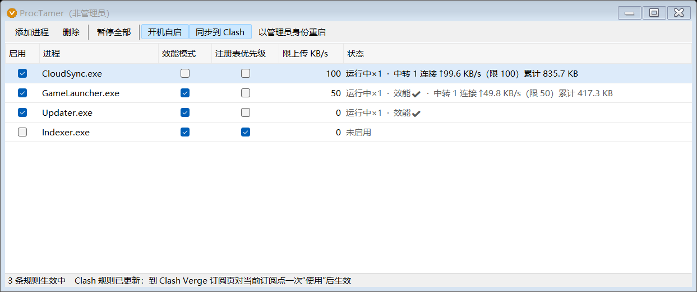

# ProcTamer

[English](README.md) | **简体中文**

ProcTamer 是一款 Windows 托盘工具，用于按进程名称约束后台程序对系统资源的占用：降低其 CPU 与磁盘优先级，并限制其上传速率。

本程序的主要特点是：**在代理软件开启 TUN 模式时，仍可按进程限制上传速率**（需配合 Clash Verge / mihomo）。此场景下，Windows 自带的按进程限速手段均不生效。

- 单个可执行文件，约 68 KB；不安装驱动，不注入其他进程，不挂起或结束任何进程
- 仅调用 Windows 自带功能；使用系统自带编译器即可从源码构建，无需安装开发环境
- 退出时撤销本程序所做的全部更改



*图示为使用替身程序的演示：一个进程的上传被限制在 100 KB/s，另一个被限制在 50 KB/s 并开启效能模式，状态列实时显示连接数、上传速率与累计上传量。*

界面提供**简体中文与英文**两种语言，默认跟随系统语言。

---

## 目录

1. [适用场景与解决的问题](#1-适用场景与解决的问题)
2. [功能概览](#2-功能概览)
3. [系统要求与快速开始](#3-系统要求与快速开始)
4. [界面说明](#4-界面说明)
5. [运行规则](#5-运行规则)
6. [TUN 模式下的配置](#6-tun-模式下的配置)
7. [工作原理](#7-工作原理)
8. [验证方法](#8-验证方法)
9. [实测数据](#9-实测数据)
10. [已知限制](#10-已知限制)
11. [风险提示与免责声明](#11-风险提示与免责声明)
12. [卸载与残留检查](#12-卸载与残留检查)
13. [构建与开发](#13-构建与开发)
14. [许可](#14-许可)

---

## 1. 适用场景与解决的问题

### 1.1 解决的问题

| 序号 | 问题 | 成因 | 本程序的处理方式 |
|---|---|---|---|
| 1 | 前台程序间歇性卡顿、掉帧 | 后台程序（安全扫描、反作弊、索引、更新、同步等）与前台程序争用 CPU 和磁盘 | 将指定进程置于最低 CPU 优先级与最低磁盘 I/O 优先级，前台程序优先使用资源 |
| 2 | 网络延迟周期性升高、丢包 | 后台程序突发上传，占满上行带宽。上行带宽较小的网络（家用宽带、移动热点）尤为明显 | 为指定进程设定上传速率上限，将突发流量削平 |
| 3 | 开启代理 TUN 模式后，按进程限速全部失效 | 流量先进入虚拟网卡，再由代理进程统一发出，操作系统已无法区分流量归属 | 由代理按进程名将连接转交本程序，本程序限速后再行发出 |
| 4 | 受保护的进程拒绝外部调整优先级 | 部分安全类、反作弊类进程禁止其他程序打开其句柄 | 通过系统注册表机制，使该进程在启动时即处于低优先级 |
| 5 | 同类工具需要安装内核驱动，或更改后难以还原 | — | 不使用驱动；所有更改均带有标记，退出时逐项撤销 |

被约束的进程照常运行，仅表现为运行变慢、不再抢占资源。

### 1.2 典型适用场景

| 场景 | 约束对象举例 | 建议使用的功能 |
|---|---|---|
| 网络游戏 | 反作弊后台扫描、对战平台客户端、游戏启动器的后台更新 | 效能模式、注册表优先级、限上传 |
| 视频会议、远程桌面、直播推流 | 网盘同步、备份软件、系统或软件更新 | 限上传 |
| 上行带宽紧张的网络 | 任何持续或突发上传的后台程序 | 限上传 |
| 配置较低的电脑 | 索引服务、安全软件扫描、各类后台助手 | 效能模式、注册表优先级 |
| 长期开启代理 TUN 模式 | 上述任意需要限速的程序 | 限上传 + 同步到 Clash |

首次运行时载入的预设规则以网络游戏场景为例（见 [3.3](#33-预设规则)），仅作起点。**任何进程均可通过"添加进程"加入规则表。**

### 1.3 不适用的情形

- 需要限制**下载**速率：本程序只限制上传。
- 需要限制 **UDP** 流量（TUN 模式下）：本机中转仅处理 TCP。
- 需要彻底阻止某程序联网或运行：本程序不拦截、不结束任何进程。

---

## 2. 功能概览

| 功能 | 作用 | 是否需要管理员权限 | TUN 模式下是否有效 |
|---|---|---|---|
| 效能模式 | 进程运行期间，将其设为低优先级、效能模式（EcoQoS）、极低 I/O 优先级 | 对普通进程不需要 | 是 |
| 注册表优先级 | 令系统在该进程**启动时**直接赋予低优先级，适用于拒绝访问的受保护进程 | 需要 | 是 |
| 限上传（系统 QoS） | 通过 Windows 策略式 QoS 按程序名限速 | 需要 | **否** |
| 限上传（本机中转） | 代理将该进程的 TCP 连接转交本程序，以令牌桶限制上传；下载不限 | 不需要 | 是 |
| 同步到 Clash | 将需限速的进程名单自动写入 Clash Verge 全局扩展脚本，并随规则变化自动更新 | 不需要 | 是 |
| 状态显示 | 逐条显示规则是否生效、进程是否运行、中转连接数、上传速率与累计量 | — | — |
| 托盘常驻与开机自启 | 关闭窗口后驻留托盘；可登记为登录时以管理员权限静默启动 | 开机自启需要 | — |

"限上传 KB/s"为同一数值，两种限速方式共用：未开启 TUN 时由系统 QoS 执行；开启 TUN 且代理规则就绪后由本机中转执行。

---

## 3. 系统要求与快速开始

### 3.1 系统要求

- Windows 10 或 Windows 11，64 位
- 系统自带的 .NET Framework 4.x（无需另行安装）
- 使用 TUN 模式下的限速功能时：Clash Verge 或其他基于 mihomo 内核的客户端

### 3.2 快速开始

1. 下载本仓库（`Code → Download ZIP` 后解压，或 `git clone`）。
2. 双击 `build.cmd`，在同一目录生成 `ProcTamer.exe`。
3. 运行 `ProcTamer.exe`。首次运行载入预设规则，**全部默认不启用**。
4. 在需要约束的进程所在行勾选"启用"，按需勾选功能或填写限速值。
5. 需要使用"注册表优先级"、系统 QoS 限速或开机自启时，点击工具栏的"以管理员身份重启"。
6. 如平时开启代理 TUN 模式，点击工具栏的"同步到 Clash"，随后在 Clash Verge 订阅页对当前订阅点击一次"使用"。详见[第 6 节](#6-tun-模式下的配置)。

### 3.3 预设规则

| 进程 | 说明 | 效能模式 | 注册表优先级 | 限上传 KB/s |
|---|---|---|---|---|
| `SGuard64.exe` | 腾讯 ACE 反作弊 | 是 | 是 | 0 |
| `SGuardSvc64.exe` | 腾讯 ACE 反作弊 | 是 | 是 | 0 |
| `完美世界竞技平台.exe` | 完美世界竞技平台主程序 | 否 | 否 | 100 |
| `pwautil64.exe` | 完美世界竞技平台组件 | 否 | 否 | 100 |
| `WmgpOptimizer_x64.exe` | 完美世界竞技平台组件 | 否 | 否 | 100 |
| `5EClient.exe` | 5E 对战平台主程序 | 否 | 否 | 100 |
| `Bucky64.exe` | 5E 对战平台目录下的组件（推测为反作弊） | 否 | 否 | 100 |

不需要的预设可直接删除。

---

## 4. 界面说明

### 4.1 规则表各列

| 列 | 含义 |
|---|---|
| 启用 | 该条规则的总开关。未勾选时，该行其余设置均不生效 |
| 进程 | 程序名（不含路径），不区分大小写 |
| 效能模式 | 进程运行期间将其设为低优先级、效能模式、极低 I/O 优先级 |
| 注册表优先级 | 在注册表登记"该程序启动时即为低优先级"，仅对此后启动的进程生效 |
| 限上传 KB/s | 上传速率上限，`0` 表示不限。1 KB 按 1000 字节计 |
| 状态 | 该条规则当前的实际效果，见 4.2 |

### 4.2 状态列

| 显示内容 | 含义 |
|---|---|
| `未启用` / `已暂停` | 规则未生效 |
| `未运行` / `运行中×3` | 该进程当前的实例数 |
| `效能✔` | 效能模式已套用 |
| `效能✘ 拒绝访问` | 进程受保护，无法调整。请改用"注册表优先级" |
| `注册表✔` | 注册表项已写入，该进程下次启动时生效 |
| `注册表✘ 需管理员` | 当前非管理员权限 |
| `注册表✘ 已有其他设置` | 该程序已存在其他来源的优先级设置，本程序不予覆盖 |
| `限速✔ 100KB/s` | 系统 QoS 策略已建立 |
| `限速✘ 流量走 Meta（TUN），等待中转连接` | 检测到 TUN，系统 QoS 无效，且尚无连接经中转到达（代理规则未就绪，或该进程当前未联网） |
| `限速✘ 中转未启动` | 本机 17877 端口监听失败，底部状态栏给出原因 |
| `中转 2 连接 ↑37.5 KB/s（限 100）累计 1.2 MB` | 正在经中转转发：当前连接数、上传速率、累计上传量 |

### 4.3 工具栏与托盘

| 控件 | 作用 |
|---|---|
| 添加进程 | 新增规则。可从正在运行的进程中选择，也可直接输入程序名 |
| 删除 | 删除选中的规则 |
| 暂停全部 / 恢复全部 | 令全部规则临时失效或恢复。暂停期间中转照常转发，不限速 |
| 开机自启 | 登记或取消登录时自动启动（管理员权限、静默进入托盘） |
| 同步到 Clash | 开启或关闭向 Clash Verge 全局扩展脚本的同步。按钮高亮表示已开启 |
| 以管理员身份重启 | 仅在非管理员运行时显示 |
| 托盘图标 | 绿色：运行中；灰色：已暂停；橙色：非管理员。双击显示主窗口 |

点击窗口关闭按钮仅将程序收入托盘。**托盘右键菜单中的"退出并还原"才会真正退出。**

### 4.4 界面语言

界面提供简体中文与英文两种语言。默认跟随 Windows 显示语言：中文系统显示中文，其余显示英文。如需指定，右键托盘图标 → "语言 / Language" → "跟随系统""中文"或"English"。切换即时生效并予以保存。

---

## 5. 运行规则

本节以条款形式说明本程序的确定行为。

### 5.1 规则匹配与生效

1. 规则按**程序名**匹配进程，不含路径，不区分大小写。同名的全部进程实例均适用同一条规则。
2. 一条规则在同时满足以下条件时生效：已勾选"启用"，且未处于"暂停全部"状态。
3. 本程序每 2 秒扫描一次进程列表。规则变更后立即执行一次。
4. 规则表保存在可执行文件同目录下的 `rules.tsv`，每次变更后即时写入。
5. 本程序为单实例运行，重复启动时提示已在运行。

### 5.2 效能模式

1. 对生效规则所匹配的每个进程，设置：空闲（Idle）优先级类、EcoQoS 执行速度限制、极低（Very Low）I/O 优先级。
2. 规则停用、暂停、删除或程序退出时，将此前处理过的进程恢复为**普通（Normal）**优先级类，并取消 EcoQoS，I/O 优先级恢复为普通。恢复前核对进程名，以防进程号被复用。
3. 目标进程拒绝访问时不重试其他手段，状态列如实显示。

### 5.3 注册表优先级

1. 仅在管理员权限下执行。
2. 写入位置为 `HKLM\SOFTWARE\Microsoft\Windows NT\CurrentVersion\Image File Execution Options\<程序名>\PerfOptions`，写入 `CpuPriorityClass=1`、`IoPriority=0`，并附加标记值 `ProcTamer=1`。
3. 该位置已存在不带本程序标记的设置时，不覆盖、不修改。
4. 规则停用、暂停、删除或程序退出时，删除带有本程序标记的项；不带标记的项不触碰。
5. 该设置仅对写入之后启动的进程生效，对已在运行的进程无效。

### 5.4 限上传

1. 限速值单位为 KB/s，1 KB = 1000 字节。`0` 表示不限速。
2. 仅限制上传方向（本机进程 → 外部网络）。下载方向不受限制。
3. 系统 QoS 方式：仅在管理员权限下执行；策略名以 `ProcTamer_` 为前缀，写入 `ActiveStore`（不持久化，重启后自动消失）；规则每次变更时先删除全部本程序策略再重建；程序退出时全部删除。
4. 本程序检测外网流量的出口网卡。出口为虚拟网卡时，判定系统 QoS 方式无效，并在状态列标明。

### 5.5 本机中转

1. 本程序运行期间，始终在 `127.0.0.1:17877` 监听，端口独占，不接受来自其他主机的连接。
2. 协议为 SOCKS5。仅接受用户名/密码认证方式；**用户名即进程名**，密码不校验。
3. 仅支持 `CONNECT` 命令（TCP）。`BIND`、`UDP ASSOCIATE` 及不带用户名的连接一律拒绝。
4. 用户名对应的规则生效且限速值大于 0 时，对该连接的上传方向限速；否则照常转发，不限速。用户名无对应规则的连接同样照常转发。
5. 同一进程名的全部连接共用一个令牌桶，即限速值为该进程所有连接的合计上限。
6. 本程序仅转发数据，不解析、不修改、不记录连接内容。
7. 目标地址为域名时，由本程序解析，优先使用 IPv4 地址，最多尝试 3 个地址，单个地址连接超时为 10 秒。握手超时为 10 秒。
8. 程序退出时停止监听，已建立的中转连接随之断开。

### 5.6 同步到 Clash

1. 操作对象仅限一个文件：`%APPDATA%\io.github.clash-verge-rev.clash-verge-rev\profiles\Script.js`，即 Clash Verge 的全局扩展脚本。该文件不存在时，本功能不执行任何写入。
2. 本功能默认关闭，须由用户点击"同步到 Clash"并确认后开启。是否开启以该文件中是否存在本程序的标记为准。
3. 本程序仅改写 `// BEGIN PROCTAMER` 与 `// END PROCTAMER` 两个标记之间的内容。标记之外的内容，除第 5 条所述的一行调用外，不作任何改动。
4. 首次写入前，将原文件备份至上一级目录，文件名为 `Script.js.bak-<年月日时分秒>-proctamer`。此后的更新不再备份。
5. 首次写入时按以下情形处理：
   - 文件为 Clash Verge 的空白模板，或为本项目提供的独立脚本 `proctamer-relay.js`：整体替换为"标记段 + 仅调用该段的 `main` 函数"；
   - 文件已有其他内容：将标记段置于文件开头，并在原有 `main` 函数体的第一行加入 `config = procTamerRelay(config);`；
   - 文件中找不到 `main` 函数：不写入，并报告原因。
6. 写入名单的进程为：规则表中**限上传大于 0 的全部规则**，不论其是否勾选"启用"。程序名含有逗号或圆括号的规则不写入（代理规则语法不允许）。
7. 开启后，本程序在启动时及每次规则变更时比对名单，内容有变化才改写文件。
8. 脚本文件的修改时间晚于 Clash Verge 运行配置的生成时间时，状态栏提示需在 Clash Verge 中重新加载配置。**本程序不会、也无法替用户触发重新加载。**
9. 再次点击"同步到 Clash"并确认后，移除标记段及第 5 条所述的调用行，其余内容保留。
10. 保持原文件的换行风格（LF 或 CRLF），以 UTF-8（无 BOM）写入。

### 5.7 权限

| 操作 | 所需权限 |
|---|---|
| 效能模式（普通进程）、本机中转、同步到 Clash | 普通用户 |
| 效能模式（其他用户或受保护的进程） | 管理员；受保护进程可能仍被拒绝 |
| 注册表优先级、系统 QoS 限速、开机自启 | 管理员 |

本程序以普通权限启动，不主动申请提权。提权仅在用户点击"以管理员身份重启"时发生。

### 5.8 退出与还原

1. 通过"退出并还原"退出时，依次执行：停止本机中转；恢复已处理进程的优先级；删除带本程序标记的注册表项；删除全部 `ProcTamer_*` QoS 策略。
2. 以下各项**不随退出撤销**，须由用户在程序内关闭：开机自启的计划任务；Clash Verge 全局扩展脚本中的标记段。
3. 程序被强制结束或系统异常关机时，无法执行还原。此时 QoS 策略于重启后自动消失；注册表项保留，并在本程序下次启动时按当前规则重新同步。

### 5.9 本程序不做的事

- 不结束、不挂起、不注入任何进程，不读写其他进程的内存。
- 不安装驱动、服务或系统级钩子。
- 不拦截、不解密、不修改、不记录任何网络内容。
- 不主动发起任何网络连接；不收集、不上传任何数据。
- 不修改代理软件的订阅内容，不修改除 5.6 所述文件以外的任何代理配置文件。

---

## 6. TUN 模式下的配置

### 6.1 为何需要额外配置

代理软件开启 TUN 后，所有程序的流量先进入一块虚拟网卡，再由代理进程从物理网卡发出。此时：

- Windows 的 QoS 限速只绑定于物理网卡，在虚拟网卡上不生效；
- 流量到达物理网卡时已全部归属代理进程，无法再按原程序区分。

因此，系统自带的按进程限速手段（QoS 策略、作业对象）在 TUN 模式下均无效。本程序改在另一位置限速：**代理仍然掌握每条连接所属的进程，由它将指定进程的连接转交本程序。**

```
被限速的进程
   │  TCP
   ▼
虚拟网卡（TUN）
   │
   ▼
代理内核（mihomo）── 按进程名匹配规则
   │  SOCKS5，用户名 = 进程名
   ▼
ProcTamer 本机中转 127.0.0.1:17877 ── 令牌桶限制上传
   │  由 ProcTamer.exe 发出
   ▼
代理内核 ── 规则：ProcTamer.exe 一律直连
   │
   ▼
物理网卡 → 互联网
```

### 6.2 方式一：同步到 Clash（推荐，适用于 Clash Verge）

1. 在 ProcTamer 工具栏点击"同步到 Clash"并确认。
2. 在 Clash Verge 的订阅页，右键当前订阅并点击一次"使用"，使其重新生成配置。

本节涉及的 Clash Verge 界面名称（以 2.5.8 版为准）：

| 中文界面 | 英文界面 | 位置 |
|---|---|---|
| 订阅 | Profiles | 导航栏 |
| 使用 | Select | 订阅的右键菜单 |
| 全局扩展脚本 | Global Extend Script | 订阅页 |
| 扩展脚本 | Extend Script | 订阅的右键菜单（订阅级脚本） |
| 规则 / 代理 / 连接 | Rules / Proxies / Connections | 导航栏 |

此后的操作与是否需要重新加载的对应关系如下：

| 在 ProcTamer 中的操作 | 脚本是否更新 | 是否需要在 Clash Verge 再点"使用" |
|---|---|---|
| 添加或删除带限速值的进程 | 是 | 是 |
| 将某进程的限速值由 0 改为非 0，或由非 0 改为 0 | 是 | 是 |
| 调整限速数值（始终大于 0） | 否 | 否，立即生效 |
| 勾选或取消"启用"，暂停或恢复全部 | 否 | 否，立即生效 |

写入后的脚本结构如下，具体规则见 [5.6](#56-同步到-clash)：

```js
// BEGIN PROCTAMER
// ……由 ProcTamer 自动维护的 procTamerRelay(config) 函数……
// END PROCTAMER

function main(config, profileName) {
  config = procTamerRelay(config);   // 本程序加入的唯一一行调用
  // 此处可继续编写其他自定义逻辑
  return config;
}
```

### 6.3 方式二：手动安装独立脚本（适用于 Clash Verge）

如不希望由本程序改写 Clash Verge 的文件，可手动安装。仓库中的 [`proctamer-relay.js`](proctamer-relay.js) 为独立版本，效果与方式一生成的标记段完全相同。

1. 打开 Clash Verge → 订阅页 → "全局扩展脚本"。
2. 先将原有内容另存备份，再以 `proctamer-relay.js` 的内容整体替换并保存。
3. Clash Verge 将重新生成配置。未生效时，对当前订阅再点击一次"使用"。

采用此方式时，增减进程须自行修改脚本开头的 `PROCESSES` 数组，并在 ProcTamer 中添加同名规则。

### 6.4 方式三：手写配置（适用于其他 mihomo 客户端）

为每个进程各写一组如下内容。规则须置于其他规则之前。

```yaml
proxies:
  - name: ProcTamer-Relay example.exe
    type: socks5
    server: 127.0.0.1
    port: 17877
    username: example.exe       # 用户名即进程名
    password: proctamer         # 任意非空值，中转不校验密码
    udp: false

proxy-groups:
  - name: ProcTamer example.exe
    type: fallback
    proxies:
      - ProcTamer-Relay example.exe
      - DIRECT
    url: http://www.msftconnecttest.com/connecttest.txt
    interval: 30
    timeout: 3000
    lazy: false

rules:
  - PROCESS-NAME,ProcTamer.exe,DIRECT
  - AND,((PROCESS-NAME,example.exe),(NETWORK,TCP)),ProcTamer example.exe
```

凡能够"按进程名将 TCP 连接转交给一个带用户名的 SOCKS5 出口"的代理软件，均可按同一思路接入。

### 6.5 脚本所做的更改

三种方式的效果一致：在订阅原有内容的基础上追加节点、策略组与规则，不改动原有配置。

| 追加内容 | 名称 | 说明 |
|---|---|---|
| 节点 | `ProcTamer-Relay <进程名>` | `socks5`，`127.0.0.1:17877`，用户名为进程名 |
| 策略组 | `ProcTamer <进程名>` | `fallback`：`[上述节点, DIRECT]`，每 30 秒健康检查一次 |
| 规则 | `AND,((PROCESS-NAME,<进程名>),(NETWORK,TCP)),ProcTamer <进程名>` | 仅匹配该进程的 TCP 连接 |
| 规则 | `PROCESS-NAME,ProcTamer.exe,DIRECT` | 置于最前，确保本程序发出的连接不被再次转回中转 |

策略组类型为 `fallback`：**ProcTamer 未运行时健康检查失败，流量自动改走直连**，不会造成断网。

Clash Verge 按固定顺序应用各项扩展：订阅原文 → 应用设置 → 全局扩展配置 → 全局扩展脚本 → 订阅扩展配置 → 订阅扩展脚本 → 应用设置回写。因此全局脚本先于订阅级脚本执行；订阅级脚本如在最前面插入自己的规则，这些规则会排在本程序所加规则之上。

### 6.6 撤销

- 方式一：再次点击"同步到 Clash"并确认，随后在 Clash Verge 点击一次"使用"。
- 方式二：将全局扩展脚本恢复为默认内容并保存：

  ```js
  // Define main function (script entry)

  function main(config, profileName) {
    return config;
  }
  ```

- 方式三：删除所添加的节点、策略组与规则。

仅需临时取消限速时无须改动代理：在 ProcTamer 中点击"暂停全部"，或直接退出 ProcTamer（约 30 秒内自动回落直连）。

---

## 7. 工作原理

### 7.1 效能模式

对匹配的进程依次调用：

- `SetPriorityClass(IDLE_PRIORITY_CLASS)`：最低 CPU 优先级类；
- `SetProcessInformation(ProcessPowerThrottling)`：开启 EcoQoS，即任务管理器中的"效能模式"；
- `NtSetInformationProcess(ProcessIoPriority = VeryLow)`：最低磁盘 I/O 优先级。

### 7.2 注册表优先级

利用 Windows 自带的 Image File Execution Options 机制。内核在创建进程时读取 `PerfOptions` 并直接套用，故对拒绝外部修改的受保护进程同样有效。

### 7.3 系统 QoS 限速

通过 Windows PowerShell 调用 `New-NetQosPolicy`，以程序名为匹配条件建立限速策略。换算关系为 `KB/s × 8000 = bit/s`。

### 7.4 本机中转与令牌桶

| 参数 | 取值 |
|---|---|
| 速率 | `限上传 KB/s × 1000` 字节/秒 |
| 桶容量 | 0.25 秒的流量，不少于 4096 字节 |
| 最小放行块 | `速率 ÷ 50`，不少于 512 字节（避免将数据切分为大量小包） |

令牌不足时，本程序暂停从代理读取数据。TCP 流量控制将此压力逐级传回原进程，使其自行降低发送速率，数据不在中间环节堆积。

连接的一个方向结束后，另一方向最多保留 60 秒用于收尾；两端均启用 TCP keepalive（空闲 60 秒后探测）。

---

## 8. 验证方法

**（1）中转是否在监听**

```powershell
Get-NetTCPConnection -LocalPort 17877 -State Listen
```

**（2）手动经中转发起一次请求**（用户名填写规则表中任一进程名）

```powershell
curl.exe --socks5-hostname 127.0.0.1:17877 --proxy-user "example.exe:x" http://www.msftconnecttest.com/connecttest.txt
```

应输出 `Microsoft Connect Test`，同时 ProcTamer 中对应行出现中转统计。

**（3）代理规则是否已加载**：Clash Verge 规则页的靠前位置可见 `PROCESS-NAME,ProcTamer.exe,DIRECT` 及各进程的 `AND,(...)` 规则；代理页中 `ProcTamer <进程名>` 组在 ProcTamer 运行时选中的是 `ProcTamer-Relay ...`。

**（4）真实流量**：目标进程运行时，代理连接页中其 TCP 连接应显示经由 `ProcTamer-Relay`；ProcTamer 状态列显示连接数，上传速率不超过限速值。

**（5）限速是否对症**：如上行突发依旧存在，而对应进程的中转累计量几乎不增长，说明该部分数据使用 UDP 传输，不在本程序处理范围内（见[第 10 节](#10-已知限制)）。

---

## 9. 实测数据

测试环境：Windows 11；Clash Verge 2.5.8（Mihomo Meta v1.19.32），TUN 开启。上传目标为本机 HTTP 接收端，以改名后的 `curl.exe` 模拟目标进程。

| 测试项 | 结果 |
|---|---|
| 规则 100 KB/s，上传 500 KB | 4.78 秒（理论值 4.75 秒） |
| 规则 50 KB/s，中文进程名，经 mihomo 进程规则转入，上传 500 KB | 9.76 秒（理论值 9.75 秒） |
| 同一规则下载 5 MB | 0.02 秒，不受限 |
| 规则未启用，或用户名无对应规则 | 照常转发，不限速 |
| 不带用户名连接中转 | 被拒绝 |
| 未列入代理规则的进程 | 按原有规则处理，不经中转 |
| ProcTamer 退出后 | 健康检查失败，同一进程自动改走直连 |
| TUN 开启时代理连接 `127.0.0.1:17877` | 健康检查通过 |
| 同步到 Clash：空白模板、已有其他内容、名单变更、移除、CRLF 文件等 24 项检查 | 全部通过；移除后文件与原文件逐字一致 |

理论值算法：`(数据量 − 桶容量) ÷ 速率`。例：`(500000 − 25000) ÷ 100000 = 4.75` 秒。

以下部分尚未充分实测，特此说明：

- "注册表优先级"与系统 QoS 限速需管理员权限，目前仅完成功能实现，未在真实的受保护进程上作长时间验证；
- "同步到 Clash"按钮的界面点击流程未作自动化测试，已测试其调用的写入、移除逻辑及启动时的自动更新；
- 程序运行期间通过托盘菜单切换语言，未作自动化测试；启动时按系统语言及按已保存设置选择语言，已测试。
- 针对具体软件的实际效果，取决于其上传使用 TCP 还是 UDP。

---

## 10. 已知限制

1. **仅处理 TCP。** UDP 流量不经中转，仍按代理原有规则处理，不限速。
2. **经中转的进程一律直连出网。** 这些进程的 TCP 连接由 ProcTamer 直接发出，不再按代理订阅中的域名规则分流；原本经代理节点的连接亦改为直连。
3. **名单变更后须手动重新加载。** Clash Verge 仅在重新生成配置时读取脚本，本程序无法代为触发。
4. **"同步到 Clash"仅支持 Clash Verge。** 按固定路径查找其全局扩展脚本；其他客户端请采用手写配置。
5. **退出时存在短暂空窗。** ProcTamer 退出后至代理下一次健康检查之间（最长约 30 秒），相关进程的新连接将失败，随后自动回落直连。
6. **健康检查会产生少量统计。** 代理每 30 秒检查一次中转是否可用，状态列中会偶尔出现 1 个连接及少量累计流量，属正常现象。
7. **注册表优先级非即时生效。** 仅对此后启动的进程有效。
8. **优先级恢复为"普通"而非原值。** 进程原本使用其他优先级类时，停用规则后将变为普通优先级。
9. **异常退出不执行还原。** 见 [5.8](#58-退出与还原) 第 3 条。
10. **系统 QoS 在部分家用环境中可能不生效。** 此为 Windows 策略式 QoS 自身特性。状态列显示 `限速✔` 仅表示策略已建立，实际效果请以资源监视器为准。

---

## 11. 风险提示与免责声明

1. 本程序可用于降低安全软件、反作弊程序、对战平台等程序的优先级并限制其网络。此类做法**未获得相关软件厂商的许可**，对方是否将其视为异常行为，本项目无法保证。
2. 限速值设置过低，可能导致被约束程序数据传输不完整或连接超时，其后果（例如被判定为掉线）无法预知。建议由较宽松的数值（如 100 KB/s）起步。
3. 降低安全软件的优先级可能延长其扫描与响应时间，请自行评估。
4. 本程序不修改任何第三方程序，不读写其内存，不拦截或伪造任何数据，仅调整优先级与转发速率。
5. 本程序按"现状"提供，不附带任何明示或默示的保证。使用本程序所产生的一切后果由使用者自行承担。详见 [LICENSE](LICENSE)。

---

## 12. 卸载与残留检查

卸载步骤：

1. 如已开启"开机自启"，在程序内点击一次将其关闭（或在任务计划程序中删除名为 `ProcTamer` 的任务）。
2. 如已开启"同步到 Clash"，再次点击将其关闭（手动安装的脚本请自行恢复默认内容），并在 Clash Verge 点击一次"使用"。
3. 通过托盘菜单"退出并还原"。
4. 删除程序所在目录。

残留检查（管理员 PowerShell）：

```powershell
Get-NetQosPolicy -PolicyStore ActiveStore | Where-Object Name -like 'ProcTamer_*'
Get-ScheduledTask -TaskName ProcTamer -ErrorAction SilentlyContinue
Get-ChildItem 'HKLM:\SOFTWARE\Microsoft\Windows NT\CurrentVersion\Image File Execution Options' |
    Where-Object { (Get-ItemProperty "$($_.PSPath)\PerfOptions" -ErrorAction SilentlyContinue).ProcTamer }
```

三条命令均无输出，即表示无残留。

---

## 13. 构建与开发

### 13.1 文件说明

| 文件 | 说明 |
|---|---|
| `ProcTamer.cs` | 全部源码，单文件 |
| `app.manifest` | 应用清单：普通权限启动、DPI 感知、新版控件样式 |
| `build.cmd` | 一键构建脚本 |
| `proctamer-relay.js` | Clash Verge 全局扩展脚本的独立版本，供手动安装 |
| `rules.tsv` | 运行后自动生成的规则文件（不纳入仓库） |

### 13.2 构建

`build.cmd` 实际执行的命令：

```bat
"%WINDIR%\Microsoft.NET\Framework64\v4.0.30319\csc.exe" /nologo /target:winexe /optimize+ /platform:x64 ^
  /codepage:65001 /win32manifest:app.manifest /out:ProcTamer.exe ^
  /r:System.dll,System.Core.dll,System.Drawing.dll,System.Windows.Forms.dll ProcTamer.cs
```

修改源码时请注意：

- 系统自带的该编译器仅支持至 **C# 5**。不可使用字符串内插（`$"..."`）、`?.`、`out var`、表达式体成员、`nameof` 等较新语法；可使用 `async` / `await`，但 `catch` / `finally` 块内不可 `await`。
- 源码为 UTF-8 编码，故构建参数含 `/codepage:65001`。
- `build.cmd` 须保持 **CRLF** 换行，否则 cmd 会将中文注释的一部分当作命令执行。仓库的 `.gitattributes` 已作约束。
- 程序运行期间可执行文件被占用，重新构建前须先退出。

### 13.3 规则文件格式

`rules.tsv` 与可执行文件位于同一目录，UTF-8 编码，每行一条规则，以制表符分隔：

```
启用	进程名	效能模式	注册表优先级	限速KB/s
```

布尔值以 `1` / `0` 表示。示例：

```
1	example.exe	0	0	100
```

如已明确指定界面语言，文件中另有一行 `#lang<制表符>en` 或 `#lang<制表符>zh`。

删除该文件后重新启动，即恢复为预设规则。

### 13.4 命令行参数

| 参数 | 作用 |
|---|---|
| `--tray` | 启动后不显示窗口，直接进入托盘（开机自启即使用此参数） |
| `--wait` | 等待上一实例退出后再启动（提权重启时内部使用） |
| `--clash-dir <目录>` | 指定 Clash Verge 数据目录（其中须有 `profiles\Script.js`）。默认为 `%APPDATA%\io.github.clash-verge-rev.clash-verge-rev` |
| `--lang <en\|zh>` | 仅本次运行使用指定的界面语言，不保存 |
| `--relay-port <端口>` | 调试用：改用其他中转端口。生成的 Clash 脚本仍指向 17877 |
| `--shot <png路径>` | 调试用：启动后将窗口绘制为图片保存并退出，不占用单实例锁。此模式下未指定 `--clash-dir` 时不读写 Clash 的文件 |
| `--shot-after <毫秒>` | 配合 `--shot`，指定截图前的等待时间，默认 1500。不可与 `--tray` 同用 |

---

## 14. 许可

本项目以 [MIT 许可](LICENSE) 发布。
